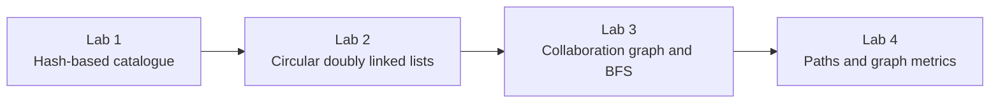

# EDA - Data Structures and Algorithms

[](https://www.java.com/)
[](#learning-progression)
[](LICENSE)

A collaborative series of **four progressive Java laboratories** built around a large actor-and-film dataset. The project evolves from an in-memory catalogue with fast keyed lookup to custom linked structures, shortest-path searches in an actor collaboration graph, and sampled graph metrics.

The laboratories were developed by [Mikel Barcina](https://github.com/mbarcina001) and [Jose Ángel Gumiel](https://github.com/jagumiel) for a **Data Structures and Algorithms** course.

> [!NOTE]
> This is a historical academic project from 2013-2014. Each laboratory is preserved as an independent Eclipse project and represents the state of the implementation at that stage. The learning objectives are incremental, although not every experimental structure introduced in one laboratory is retained in the following source snapshot.

## Project highlights

- Parsing of a legacy IMDb-style text dataset containing actors and filmographies.
- Fast actor and film lookup using `HashMap`.
- Manual implementation of generic circular doubly linked lists and iterators.
- Ordered and unordered list variants defined through ADT interfaces.
- Construction of actor-to-film and film-to-cast relationships.
- Actor collaboration graph derived from shared film appearances.
- Breadth-first traversal for reachability and minimum collaboration distance.
- Path reconstruction with predecessor references and a stack.
- Sampling-based estimation of average separation and graph centrality.
- JUnit 4 and purpose-built test programs.
- Four detailed design reports covering alternatives, complexity and test cases.

## Learning progression



The progression is conceptual and functional:

1. **Model and retrieve the data.**
2. **Implement a core data structure instead of relying exclusively on library collections.**
3. **Turn the catalogue into a graph and traverse it efficiently.**
4. **Use repeated traversals to extract global information from the network.**

The source directories remain separate submissions rather than versions of one shared module. In particular, Lab 2 applies its custom list to the Lab 1 domain, while Labs 3 and 4 continue the catalogue-and-graph branch without carrying every Lab 2 class forward.

## Repository map

| Path | Stage | Main contribution |
| --- | --- | --- |
| [`lab1/`](lab1/) | Catalogue foundation | File parsing, actor and film modelling, CRUD operations, hash-based lookup, alphabetical output and persistence. |
| [`lab2/`](lab2/) | Custom data structures | Generic circular doubly linked list, ordered and unordered variants, iterator implementation and integration with the actor catalogue. |
| [`lab3/`](lab3/) | Graph traversal | Cast and colleague relationships, custom queue, actor reachability and minimum collaboration distance. |
| [`lab4/`](lab4/) | Network analysis | Path reconstruction, average-distance estimation, degree-based ranking and sampled betweenness-style centrality. |
| [`Docs/`](Docs/) | Design reports | Original reports for all four laboratories, including class diagrams, alternatives, complexity analysis, source listings and tests. |
| [`examen/`](examen/) | Independent exercises | Lottery-domain data-structure exercises with `Boleto`, `Bombonera`, list classes and JUnit 4 tests. |

## Domain model

The first laboratory models a catalogue in which every actor has a filmography. From Lab 3 onward, every film also stores its cast. These two directions make it possible to derive an actor collaboration graph:

- **Vertex:** an actor or actress.
- **Edge:** two performers appeared in the same film.
- **Path:** a chain of collaborations connecting two performers.
- **Distance:** the number of collaboration steps in a shortest path.

The graph is therefore implicit in the actor, film, cast and colleague collections; it is not loaded from a separate edge-list file.

## Laboratory details

### Lab 1 - Hash-based actor and film catalogue

Lab 1 establishes the domain model and the data-processing workflow:

- load an IMDb-style text file;
- parse actors and their filmographies;
- search actors and films by name or title;
- add and remove catalogue entries;
- produce an alphabetically ordered actor list;
- save the resulting data to a text file;
- measure loading time with `StopWatch`.

`HashMap<String, Actor>` and the corresponding film map provide average constant-time keyed access. Since a hash table does not preserve alphabetical order, the actor values are copied to an array before the implemented sorting pass.

### Lab 2 - Circular doubly linked lists

Lab 2 introduces a generic, circular, doubly linked structure:

- `DoubleLinkedList<T>` supplies common access, search, removal, size and iteration operations.
- `UnorderedDoubleLinkedList<T>` adds front, rear and positional insertion.
- `OrderedDoubleLinkedList<T>` inserts values according to their ordering.
- `Node<T>` maintains both `next` and `prev` references.
- `ListADT`, `OrderedListADT` and `UnorderedListADT` define the expected operations.

The exercise also integrates the new structure into the actor application and includes dedicated test programs for list behaviour and ordered insertion.

### Lab 3 - Actor collaboration graph and BFS

Lab 3 extends the catalogue into a network:

- an actor stores the performers with whom they have worked;
- a film stores its cast;
- loading the dataset builds both directions of the relationship;
- a FIFO queue manages actors that remain to be examined;
- visited actors prevent repeated expansion;
- breadth-first traversal determines reachability and minimum distance.

For an unweighted graph, breadth-first search explores vertices by level, so the first discovered route to a target gives a shortest collaboration distance. Its conventional complexity is `O(V + E)` for the explored component.

### Lab 4 - Path reconstruction and graph metrics

Lab 4 reuses the collaboration graph and expands the analysis:

- `estanRelacionados(...)` returns collaboration distance.
- `estanRelacionadosBool(...)` reports whether a path exists.
- `estanRelacionadosNombres(...)` stores predecessors and reconstructs a route with a stack.
- `gradoRelaciones()` estimates mean separation from randomly selected pairs.
- `nodoCentral(...)` uses the number of direct colleagues as a degree-based centrality proxy.
- `hallarNodoCentral(...)` samples shortest paths and counts intermediate appearances as an approximation to betweenness centrality.

The sampling approach is deliberate: evaluating every source-target pair in a graph with hundreds of thousands of vertices would be prohibitively expensive for the original laboratory environment.

## Data structures and complexity

| Structure or technique | Used for | Relevant cost |
| --- | --- | --- |
| `HashMap` | Actor and film lookup by name or title | Average `O(1)` search and insertion |
| Array | Sorting and fixed-size top lists | `O(n)` conversion; sorting depends on the implemented algorithm |
| Circular doubly linked list | Bidirectional traversal and end operations | `O(1)` access/removal at known ends; `O(n)` search |
| Queue | Breadth-first frontier | `O(1)` enqueue/dequeue in the array-backed implementation |
| Stack | Reversing a predecessor chain into display order | `O(1)` push/pop |
| Breadth-first search | Reachability and shortest distance in an unweighted graph | `O(V + E)` |
| Random sampling | Approximate global graph metrics | Trades exactness for tractable execution time |

## Getting started

### Requirements

- A Java Development Kit.
- Eclipse IDE is recommended for reproducing the original project layout.
- JUnit 4 for the test classes that import it.
- A graphical environment for the Swing menus and file chooser.

Most checked-in Eclipse metadata targets **Java 7**. The current Lab 2 project metadata targets Java 17, but its source retains the style and structure of the original 2013 submission.

### Import into Eclipse

1. Clone the repository:

   ```bash
   git clone https://github.com/jagumiel/EDA.git
   cd EDA
   ```

2. In Eclipse, select **File -> Import -> Existing Projects into Workspace**.
3. Import the laboratory you want to inspect (`lab1`, `lab2`, `lab3`, `lab4` or `examen`).
4. Configure a compatible JDK and add JUnit 4 where required.
5. Run the corresponding entry point:

   | Laboratory | Main class |
   | --- | --- |
   | Lab 1 | `lab1.Main` |
   | Lab 2 actor application | `actoresApp.Main` |
   | Lab 3 | `lab3.Main` |
   | Lab 4 | `lab4.Main` |

The repository includes small sample inputs in:

- [`lab1/src/lab1/actresses-small.txt`](lab1/src/lab1/actresses-small.txt)
- [`lab2/src/actoresApp/actresses-small.txt`](lab2/src/actoresApp/actresses-small.txt)
- [`lab3/actresses-small-ok.txt`](lab3/actresses-small-ok.txt)

The full dataset is not stored in the repository. The original work used the legacy frozen movie database hosted by [Freie Universität Berlin](https://ftp.fu-berlin.de/pub/misc/movies/database/frozendata/).

## Tests

Testing reflects the incremental nature of the course:

- Lab 1 contains JUnit 4 tests for actors, actor lists, film lists and file loading.
- Lab 2 contains executable test programs for the generic linked structures and their catalogue integration.
- Labs 3 and 4 include focused programs for queue behaviour, reachability, shortest-path distance and relationship-degree experiments.
- `examen` contains JUnit 4 tests for lottery tickets, number lists and ticket collections.

There is currently no repository-wide build command, automated test suite or CI workflow.

## Documentation

The original reports are written in Spanish and form an important part of the project:

- [Laboratory 1 - catalogue design, `HashMap`, sorting and tests](Docs/EDA-LAB1.pdf)
- [Laboratory 2 - circular doubly linked lists and ADTs](Docs/EDA-LAB2.pdf)
- [Laboratory 3 - actor relationships and breadth-first traversal](Docs/EDA-LAB3.pdf)
- [Laboratory 4 - average separation and centrality estimation](Docs/EDA-LAB4.pdf)

Each report records the problem statement, class design, alternatives considered, implementation decisions, complexity discussion and original test strategy.

## Compatibility and current limitations

This repository preserves the original academic work and has not yet been converted into a modern Java application:

- The laboratories are independent Eclipse projects; there is no Maven or Gradle multi-module build.
- Most projects target Java 7 and use JUnit 4.
- Some source files and comments retain legacy character encoding artefacts.
- Saving data uses hard-coded Windows paths in several `Main` classes.
- Some small demonstration programs also contain machine-specific absolute paths.
- Swing dialogs make the main workflow interactive and unsuitable for headless execution without adaptation.
- `Grafo.RecorridoEnAnchura()` is an unfinished abstraction; the working traversals are implemented directly in `Main`.
- The Lab 4 centrality methods are educational approximations, not a general-purpose graph-analysis library.
- Two historical JAR files are versioned alongside the source.

These constraints do not change the educational purpose of the repository, but they should be considered before reusing the code in another project.

## Suggested modernisation roadmap

- [ ] Add a Maven or Gradle multi-module build while preserving each laboratory as a separate stage.
- [ ] Standardise the source encoding to UTF-8.
- [ ] Replace hard-coded paths with `Path` arguments and portable output locations.
- [ ] Separate parsing, domain logic, graph algorithms and Swing interaction.
- [ ] Move traversal state out of `Actor` and into dedicated BFS result structures.
- [ ] Complete a reusable `Graph<T>` abstraction or remove the unfinished class.
- [ ] Add deterministic graph fixtures and automated tests for distance and path reconstruction.
- [ ] Make random sampling reproducible through an explicit seed and report confidence/error bounds.
- [ ] Distinguish degree centrality from sampled betweenness centrality in the API.
- [ ] Remove generated JARs from version control and publish runnable artefacts through GitHub Releases.
- [ ] Add continuous integration on a supported JDK.

## Resumen en español

Este repositorio conserva cuatro laboratorios progresivos de **Estructuras de Datos y Algoritmos** desarrollados en Java. Partiendo de un catálogo de actores y películas con búsquedas mediante `HashMap`, el trabajo incorpora listas circulares doblemente enlazadas, relaciones de colaboración entre intérpretes, recorridos en anchura para calcular caminos mínimos y estimaciones de grado medio y centralidad.

Las carpetas representan entregas independientes y permiten seguir la evolución del diseño, los algoritmos y las decisiones de eficiencia. Los informes completos de cada fase están disponibles en [`Docs/`](Docs/).

## Authors

This project was developed jointly by:

- [Mikel Barcina](https://github.com/mbarcina001)
- [Jose Ángel Gumiel](https://github.com/jagumiel)

The repository and its reports should be presented and cited as collaborative work.

## License

This project is distributed under the [MIT License](LICENSE). Copyright © 2013 Jose Ángel Gumiel and Mikel Barcina.
